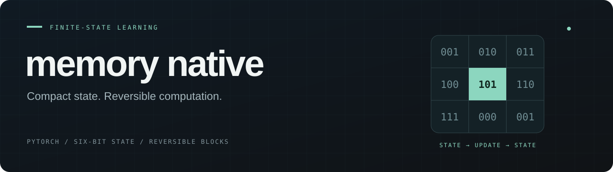

<p align="center">
  
</p>

<p align="center">
  <a href="https://github.com/kharkilirov1/memory-native/actions/workflows/ci.yml"></a>
  <a href="LICENSE"></a>
  <a href="pyproject.toml"></a>
  <a href="PROJECT_STATUS.md"></a>
</p>

<p align="center">
  <b>Training with finite-state counter synapses and reversible activations.</b><br>
  PyTorch · CPU / CUDA · experimental MLX port
</p>

<p align="center">
  <a href="#quickstart">Quickstart</a> ·
  <a href="docs/README.md">Documentation</a> ·
  <a href="results/README.md">Results</a> ·
  <a href="paper/MEMORY_NATIVE_PREPRINT.md">Preprint</a> ·
  <a href="CONTRIBUTING.md">Contribute</a>
</p>

---

Memory Native explores a compact representation for **training state**. Each counter
coefficient combines a ternary weight and an update accumulator in one finite-state code.
Packed layers store that code in **6 bits**, without a floating-point master copy or Adam
moments for the coefficient. Reversible stacks reduce saved interlayer activations by
reconstructing them during backward.

**Research status:** core operations have tests and selected hardware witnesses. Large-model
quality parity remains open. Six bits describe the coefficient code, **not total training
memory**: scales, RMS statistics, the floating-point model tail, activations and scratch
buffers are additional. See [project status](PROJECT_STATUS.md) and the
[artifact manifest](results/ARTIFACT_MANIFEST.md) before quoting results.

## What is inside

| Component | Purpose | Entry point |
|---|---|---|
| Counter synapses | Update finite-state coefficients during backward | `RMSCounterLinear` |
| Packed storage | Four coefficient codes in three bytes | `PackedRMSCounterLinear` |
| Reversible stacks | Save the final activation; reuse each branch once in backward | `ReversibleSequence` |
| CUDA kernels | Packed decode, fused updates and experimental correlation paths | [Kernel evidence](results/KERNEL.md) |
| Donor experiments | Conversion, calibration and recovery with explicit provenance | [Solver guide](docs/solver_v3_consolidated.md) |
| MLX port | Layer operations and state interchange | [MLX scope](docs/MLX_PORT.md) |

## Quickstart

```bash
git clone https://github.com/kharkilirov1/memory-native.git
cd memory-native
python -m pip install -e ".[dev]"
python examples/quickstart.py
```

The example runs offline on CPU and learns a synthetic ternary teacher. It prints loss,
actual layer-buffer storage and packed-code storage separately. It is a learning smoke
test, not a language-model benchmark. Use `--device cuda` on a configured CUDA environment.

A counter layer updates itself during `backward()`:

```python
import torch
from memory_native import PackedRMSCounterLinear

torch.manual_seed(0)
layer = PackedRMSCounterLinear(32, 32, C=11, lr=3e-3).train()
x = torch.randn(64, 32)
target = torch.randn(64, 32)

for _ in range(100):
    loss = (layer(x) - target).square().mean()
    loss.backward()

with torch.no_grad():
    prediction = layer(x)
```

There is no separate optimizer for counter coefficients. In mixed models, use a normal
optimizer for ordinary parameters such as embeddings and normalization weights.

## Choose a workflow

| I want to… | Start here |
|---|---|
| Understand the representation and update lifecycle | [Architecture](docs/ARCHITECTURE.md) |
| Run CPU correctness checks | `python -m pytest -q` — [full environment](REPRODUCIBILITY.md) |
| Compare small character models | `memory-native-charlm --config micro --steps 60 --device cpu` |
| Measure CUDA training memory | `memory-native-memgate --config s512 --optimizers adamw,galore,lomo,bnb8 --device cuda` |
| Reproduce the single-pass backward comparison | [CPU witness and command](results/REVERSIBLE_SINGLE_PASS.md) |
| Convert a donor and test cached recovery | [Public notebook](notebooks/cached_kd_public.ipynb) |
| Explore the research history | [Results index](results/README.md) · [Research directions](docs/README.md#research-directions) |

The character-model runner can fall back to synthetic text offline; supply `--data-path`
for a named corpus. Some tests and workflows need optional dependencies or hardware.
A skipped test is not a hardware validation.

## Evidence at a glance

| Area | What the repository supports | Boundary |
|---|---|---|
| Six-bit packing | Round-trip and layer-dynamics tests | Scales, statistics and other buffers add storage |
| Single-pass reversible backward | Gradient, counter-update and branch-call regression tests | Floating-point reconstruction is approximate |
| Small-model CUDA memory | T4 comparisons against AdamW and other optimizers | Short runs; counter steps were slower in the recorded comparison |
| 1.21B coefficient scale | Historical 2.25 GiB T4 fit/execution report | Primary raw log is missing; not quality parity |
| Donor recovery | Conversion and recovery experiments, including failures | Quality preservation remains unproven |
| MLX | Covered layer/state tests on Linux CPU | Apple-silicon kernel parity and performance remain open |

See the [evidence index](results/README.md) for measured values, original protocols,
negative results and missing artifacts. Kernel speedups are not whole-model speedups.

## Execution contract

- **One forward → one backward per training step.** Counter weight sharing, gradient
  accumulation, external activation checkpointing and `torch.compile` graph capture need
  an explicit scheduler and are unsupported by the ordinary eager path.
- **Deterministic reversible branches.** No dropout or forward-time state mutation in
  `F/G`. The implementation supports first-order backward. Floating-point inverse error
  depends on depth and conditioning; `anchor_every` trades memory for reconstruction
  from saved anchors.
- **Measure with `torch.no_grad()`.** Counter layers self-update in backward. Custom
  data-parallel synchronization exists; ordinary parameter-based DDP is not a substitute.

Read [architecture](docs/ARCHITECTURE.md) before integrating the layers into another model.

## Repository map

| Directory | Contents |
|---|---|
| [`src/memory_native/`](src/memory_native/) | PyTorch implementation and CUDA paths |
| [`src/memory_native_mlx/`](src/memory_native_mlx/) | Experimental MLX implementation |
| [`examples/`](examples/) | Small runnable entry points |
| [`tests/`](tests/) | Correctness and integration gates |
| [`scripts/`](scripts/) · [`notebooks/`](notebooks/) | Experiments, conversion and recovery |
| [`docs/`](docs/) · [`paper/`](paper/) | Guides, designs and preprint |
| [`results/`](results/) | Reports, raw witnesses and negative results |
| [`production/`](production/) | Campaign recipes and preflight contracts; not production-readiness certification |

[MotifCL](https://github.com/kharkilirov1/motifcl) is a separate supporting native-runtime
project. Its results do not automatically validate this implementation.

## Contributing and citation

Reproductions, counterexamples and well-scoped improvements are welcome. Start with
[contributing](CONTRIBUTING.md); use the
[reproduction template](https://github.com/kharkilirov1/memory-native/issues/new?template=reproduction_report.yml)
for empirical findings. Security reports follow [SECURITY.md](SECURITY.md).

Built with AI coding tools under Kharki’s direction. Attribution and citation metadata
are in [CITATION.cff](CITATION.cff); the [preprint](paper/MEMORY_NATIVE_PREPRINT.md) is a draft.
Licensed under [MIT](LICENSE).
